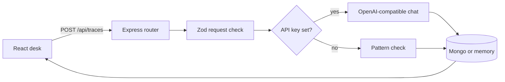

# Developer notes

This file is the map of the code. Read it before changing a route or the prompt. The product explanation for someone running the app is in [README.md](README.md).

## Shape

Two packages, one repo, npm workspaces.

```text
client/     React + Vite + Tailwind. Talks only to /api.
server/     Express. Owns validation, the model, and storage.
```

The client does not import server files. The trace contract is duplicated in `client/src/types.ts` and `server/src/types.ts` on purpose. A shared package would be a third workspace for one interface. If you add a field, change both types and the Zod schema that actually enforces the model output.



## Request path

1. `client/src/App.tsx` submits the form through `client/src/api.ts` (axios).
2. `server/src/routes/traces.ts` parses the body with Zod. A failed parse is a 400 with one sentence.
3. `translateLog` in `server/src/ai/translate.ts` either calls the model or `heuristicTranslate`.
4. The store inserts the input plus the result. The response is the saved record, including its id.
5. Errors from the store or an unexpected throw hit the handler in `server/src/app.ts` and become a 500 `{ error }`.

`GET /api/health` is how the header knows whether it is showing a model name or the words "offline pattern check".

## Model contract

`modelResultSchema` is the only shape we accept from a model:

- `likelyCause` string
- `certain` string array (1–8)
- `guessed` string array (1–8)
- `checks` exactly three strings

`source` and `model` are set by our code after parsing. The model is not allowed to claim it is the offline checker, and the offline checker is not allowed to claim it is a model.

Flow inside `translateLog`:

1. Ask with `response_format: json_object`.
2. If that flag is rejected, retry without it.
3. Strip optional markdown fences and run Zod.
4. On invalid JSON, ask once more.
5. If that still fails, or the HTTP call fails, return the heuristic result. The badge still says the result is offline.

The system prompt's important rule: never invent line numbers or file names that are not in the paste. Certain items must be visible; guessed items must be inferences. Zod checks shape, not truth.

Temperature is `0.2`.

## Offline checker

`heuristicTranslate` looks for a few common patterns (TypeError, ReferenceError, SyntaxError, "Cannot read properties of null/undefined", "is not defined", and a file:line frame). It only reports locations that the regex actually found. Checks are always the same three practical next steps. It does not invent a line number.

## Timestamp

If the log contains an ISO-like timestamp, `extractTimestamp` parses it with date-fns `parseISO`. The ISO string is stored on the result only when the parse succeeds. The client formats it with `format` only when that field is present.

## Storage

`TraceStore` in `server/src/types.ts` is the seam: `insert`, `list`, `get`, `remove`.

- `createMemoryStore` keeps an array in the process. Newest first. Used when `MONGO_URI` is empty so `npm run dev` works with zero infrastructure. Data dies with the process.
- `createMongoStore` connects with Mongoose and maps `_id` to `id` at the edge. Invalid ids return null.

`connectStore` is the only place that chooses. Routes take a `TraceStore`.

Documents are not user-scoped. There is no account system.

## UI

`App` uses TanStack Query for the list and the create/delete mutations. The selected note is an id into the query data, not a second copy in useState. After a write the query is invalidated.

Timestamps the user sees (`createdAt` and any log timestamp) go through date-fns.

All styling is Tailwind utilities. There is no hand-written CSS design system.

## Library notes

- **Tailwind CSS** (`@tailwindcss/vite`): why it is here — every visual style on the page. Used in `client/src/App.tsx` (and the single `@import "tailwindcss"` in `client/src/index.css`). Interview question it answers: "How do you style a React app without a large custom CSS file?"
- **date-fns**: why it is here — every timestamp the user sees. Used in `client/src/App.tsx` (`formatDistanceToNow`, `format`, `parseISO`) and in `server/src/ai/translate.ts` (`parseISO`, `isValid`, `format`). Interviewers still say "moment"; the answer is: Moment is legacy, mutable, and heavy; this repo uses date-fns. Example: `formatDistanceToNow(parseISO(iso), { addSuffix: true })` returns a string such as "3 hours ago".
- **axios**: why it is here — every API call from the client. Used in `client/src/api.ts`. Interview question: "How does the client talk to the API?"
- **@tanstack/react-query**: why it is here — loading, creating, and deleting server data. Used in `client/src/App.tsx` (query key `["traces"]`, `invalidateQueries` after write, `isPending`). Interview question: "How do you keep the list in sync without a second useState copy?"
- **zod**: why it is here — request bodies and model JSON. Used in `server/src/routes/traces.ts` and `server/src/ai/translate.ts` (`modelResultSchema`). Interview question: "How do you reject bad model output before it reaches the database?"
- **helmet**: why it is here — basic Express security headers. Used in `server/src/app.ts` (`app.use(helmet())`). Interview question: "What is the first middleware you add for Express security?"
- **cors**: why it is here — allow the Vite dev server. Used in `server/src/app.ts`.

Redux Toolkit is for a large shared client cache this app does not have. Server state stays in React Query; the only client-only state is the textarea value and the selected id.

## Tradeoffs

- In-memory fallback makes the repo runnable in a portfolio review. It is the wrong store for anything private or multi-instance.
- Falling back to the heuristic when the model fails keeps the demo alive. The badge is the signal.
- Duplicated types will drift if you only edit one side. The API response is the runtime contract.
- `Mixed` for the Mongo result is deliberate. The result shape is owned by Zod at write time.

## Interview walkthrough

1. The UI never calls a model. It only posts text to Express via axios.
2. Zod rejects short or huge payloads before any token is spent.
3. The model must return JSON. We parse it, check it with Zod, and retry once.
4. We label heuristic results so a missing API key cannot look like a model.
5. Mongo is optional behind a store interface. Tests hit the memory implementation and the heuristic.
6. There is no auth, so the README tells you not to deploy it with real logs.

## What I would not add next without a reason

A full log parser, multi-line frame analysis, or an AI that rewrites the code. The current gap that matters is honesty about what is in the paste versus what is guessed.
